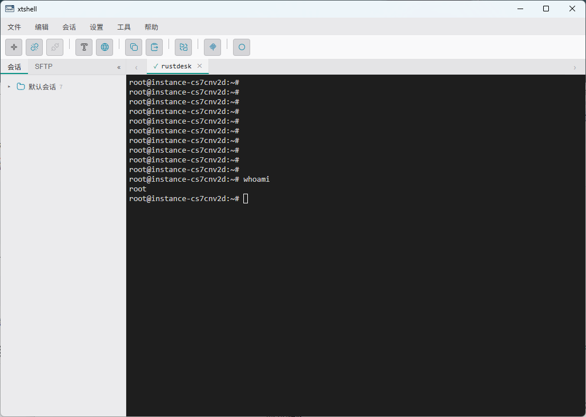
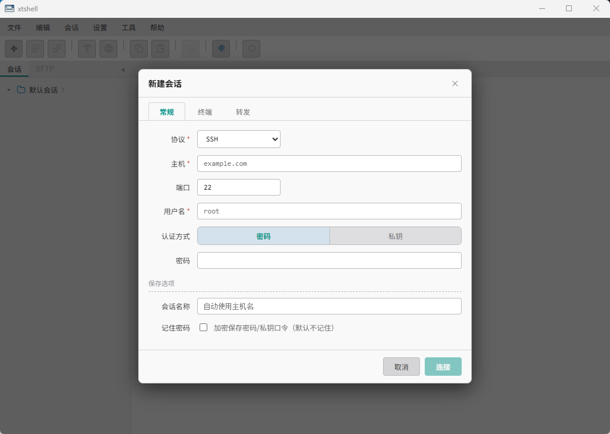
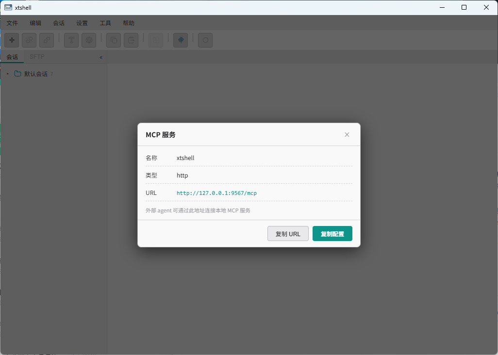

# xtshell

SSH / Telnet / Serial 终端管理工具，基于 Tauri 2 + Vue 3 + TypeScript，终端渲染使用 xterm.js。



## 功能

- **多协议**：SSH（密码 / 私钥 + 口令，兼容老式设备的旧 KEX/加密算法）、Telnet（IAC 协商过滤 + 自动登录）、Serial（串口参数可配置）
- **会话管理**：多会话并行、标签页切换，连接配置以目录树保存（可拖拽整理）
- **凭据安全**：密码与私钥口令用 AES-256-GCM 加密落盘；SSH 主机密钥经 known_hosts 校验，首次连接弹框确认指纹
- **SFTP**：在既有 SSH 会话上开 subsystem 通道，支持浏览、上传、下载、新建目录、重命名、递归删除
- **ZMODEM**：支持远端 `sz`/`rz` 双向传输，冲突时可覆盖 / 跳过 / 自动改名
- **终端体验**：GBK/UTF-8 等编码切换、全局与单会话字体/配色、会话日志（自动剥离 ANSI）、复制粘贴
- **MCP**：本地 `http://127.0.0.1:9567/mcp`，供外部 agent 创建/操作会话（菜单「工具 → MCP」查看配置）

## 系统要求与兼容性

| 平台 | 下载 | 要求 |
|---|---|---|
| Windows 10 / 11 | `xtshell-<ver>-win64-upx.exe`（免安装） | 需 WebView2 运行时（Win11 自带，Win10 一般已随 Edge 安装） |
| macOS 12+ | `xtshell_<ver>_aarch64.dmg` / `xtshell_<ver>_x64.dmg` | Apple Silicon 与 Intel 各一个包 |
| Linux x86_64 | `*.deb` / `*.rpm` | glibc ≥ 2.35、WebKitGTK 4.1 |
| Linux arm64（信创） | `*.deb` / `*.rpm` | 同上；面向鲲鹏 / 飞腾等 ARM64 机器 |

Linux 侧说明：Tauri 2 使用 WebKitGTK **4.1**（libsoup3），因此要求 glibc ≥ 2.35，对应
Ubuntu 22.04+ / Debian 12+ / Fedora 36+ / openEuler 24.03+，以及基于这些版本的新一代国产系统
（麒麟 V11、统信 UOS 25 等）。

**不支持**：麒麟 V10、统信 UOS 20 及更早版本（glibc 2.28，且只有 WebKitGTK 4.0）。

装前自检：

```bash
ldd --version | head -1                 # 需 ≥ 2.35
ls /usr/lib/*/libwebkit2gtk-4.1.so.0    # 需存在
```

## 界面预览

**支持 SSH / Telnet / Serial** —— 新建会话分「常规 / 终端 / 转发」三页，
SSH 额外支持本地端口转发（本地监听 → 经会话转发到远端）。



**原生支持 MCP** —— 内置本地 MCP 服务，Claude Code / Cursor / Codex 等 AI Agent
可直接创建并操作会话（创建、输入、读取输出）。



## 开发

需要 Node 22+、pnpm、Rust stable（Windows 上还需 MSVC 工具链与 WebView2）。

```bash
pnpm install
pnpm tauri dev     # Vite (1420) + Rust 后端
pnpm build         # vue-tsc 类型检查 + vite 构建
cd src-tauri && cargo check && cargo test
```

打包本机平台安装包：

```bash
pnpm tauri build
```

跨平台发布由 `.github/workflows/release.yml` 在推送 `v*` 标签时触发（Windows / macOS / Linux 矩阵）。

## 目录结构

```
src/                 Vue 前端（Pinia store、xterm 封装、UI 组件）
src-tauri/src/
  protocol/          SSH / Telnet / Serial 三种 TerminalStream 实现
  session/           SessionManager + 输出环形缓冲
  profile/           连接配置持久化与加密
  sftp/              SFTP 会话与文件操作
  zmodem.rs          ZMODEM 收发状态机
  mcp/               MCP 服务（rmcp + axum）
  commands.rs        前端 invoke 命令
src-tauri/vendor/    为兼容老式交换机打过补丁的 russh / ssh-encoding
```

## 许可证

[MIT](LICENSE)
